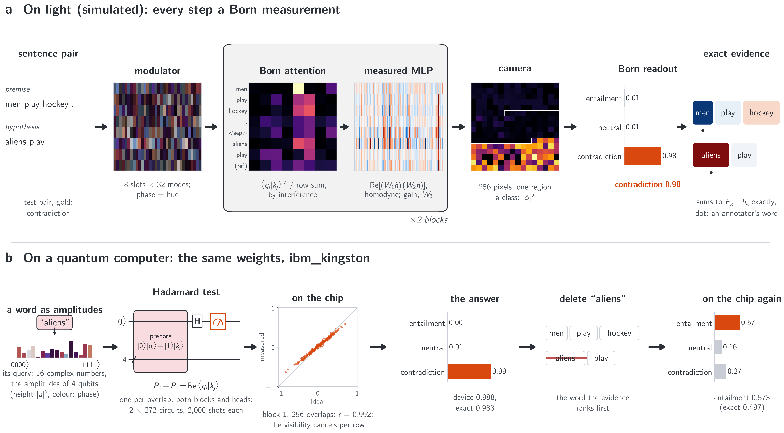
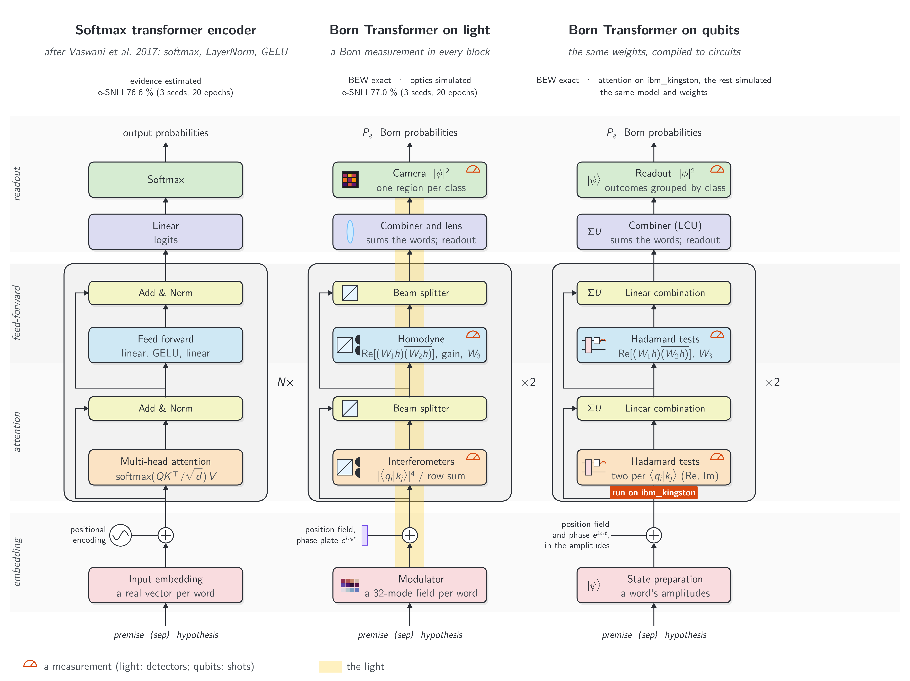

# Reading Why: Born-Measured Attention with Exact Word Evidence on Light and Qubits

Interactive companion to the paper by Teerawat Tongloy (KMITL), Jiraporn Pongsopa and Rangsan Jomtarak (Suan Dusit
University).

| | |
|---|---|
| Try it: type a premise and a hypothesis and see why the model answers (CPU, no install) | [](https://colab.research.google.com/github/stein-research/reading-why/blob/main/demo/demo.ipynb) |
| Train a model on e-SNLI (GPU) | [](https://colab.research.google.com/github/stein-research/reading-why/blob/main/demo/train.ipynb) |
| Run it on your own computer, and the paper's analyses | [docs/run-locally.md](docs/run-locally.md) |
| Paper | [arXiv:2611.05355](https://arxiv.org/abs/2611.05355) |
| Archived copy (v1.0) | [doi:10.5281/zenodo.23938334](https://doi.org/10.5281/zenodo.23938334) |
| Earlier work | Seeing Why, [arXiv:2611.01993](https://arxiv.org/abs/2611.01993) ([code](https://github.com/stein-research/seeing-why)) |



*(a) On light (simulated): one field per word on a modulator; in each of two blocks Born attention weighs the words
by interference and a measured feed-forward reads a product by homodyne detection; the camera's three regions give
the class probabilities, and each word's Born evidence (BEW; red for the answer, blue against it) sums to the class
probability above its share. (b) On IBM's ibm_kingston, with the same weights: every query-key overlap is read by
Hadamard tests on five qubits, with calibration circuits as deep in the same job; the answer survives, and each word's
evidence, with exact numerators and the attention row sums the device measured, follows the exact one (r = 0.997,
95 % interval 0.987-0.999).*

A transformer in which every step is a Born measurement: attention $|\langle q|k\rangle|^4$ normalised over each row,
a measured product in place of the feed-forward nonlinearity, and a Born readout. Each class probability is then a
ratio of polynomials in the word amplitudes, and its integrated-gradient evidence, with the denominators held, is
computed exactly by a finite quadrature: the **Born evidence per word (BEW)** adds up to the class probability above
its share.

## How it works



*One model and its realisations step by step, bottom to top, in the box colours of the original transformer figure: a
softmax transformer encoder after Vaswani et al. 2017, the Born Transformer drawn as optics, and the same Born
Transformer, with the same weights, compiled to qubits (amplitudes prepared as states, every reading a Hadamard test,
linear combinations of unitaries, a readout circuit). Its attention, two Hadamard tests per overlap with calibration
circuits as deep, is the part run on ibm_kingston; the rest is simulated. Bands hold the same stage; detector symbols
mark the measurements. The encoder is drawn in the layout of the original; our softmax baseline uses GELU, places
LayerNorm before each sublayer, averages the words before the linear head and has N = 2 blocks, as the Born
Transformer. The paper's coherent attention layer, a separate model with no measurement until the end, has its own
circuit figure.*

Each word $t$ enters as a complex field $a_t\,e_t$ with amplitude $a_t$. A block's attention weighs word $j$ for word
$i$ by

```math
w_{ij} = \frac{|\langle q_i|k_j\rangle|^4}{\sum_{j'} |\langle q_i|k_{j'}\rangle|^4},
```

which needs only overlaps (an interference on light, a Hadamard test on qubits) and a sum. The feed-forward is a
measured product $\mathrm{Re}[(W_1h)\overline{(W_2h)}]$, written back by $W_3$. The readout splits the outcomes into
one group per class $g$ and reads $P_g$; with no information each class gets its share $b_g = |S_g|/256$ (86, 85 and 85 of the 256 camera pixels, about 1/3). With every
denominator held at the input, $F_g(a) = P_g - b_g$ is a polynomial in the word amplitudes (degree 648 at most), so integrated gradients from
the zero baseline,

```math
e_g(t) = a_t \int_0^1 \frac{\partial F_g}{\partial a_t}(\alpha a)\,d\alpha, \qquad \sum_t e_g(t) = P_g - b_g,
```

are computed with no quadrature error by Gauss-Legendre quadrature (the integrand has degree 647, so 324 nodes); in
double precision the sum holds to about $10^{-12}$. Red words push towards the answer, blue words against it.

## What the paper finds (e-SNLI, about 98k parameters outside the embedding, 3 seeds, 1,000 test pairs)

| | Born Transformer | softmax transformer |
|---|---|---|
| test accuracy | 76.98 +- 0.17 % | 76.62 +- 0.36 % |
| evidence sums to the explained score | to 8e-12 at most (no quadrature error) | numerically approximated (integrated gradients); no finite-node exactness guarantee |
| deleting the word ranked first changes the answer: evidence / attention x gradient / attention / random | 45 / 37 / 32 / 5 % | 32 / 40 / 34 / 5 % |
| ... at most (any single deletion, the ceiling) | 53 % | 55 % |
| deleting the five words ranked last changes it (evidence) | 0.9 % | 10 % |
| top words that annotators highlighted: evidence / attention (chance 0.35) | 0.51 / 0.50 | 0.46 / 0.54 |

The softmax model's evidence here is integrated gradients of its probability over one gate per word, the same path
and explained quantity as the Born evidence. Attention looks most like the annotators' reason, yet accounts for the
answer less well. The same trained weights compile exactly to optics (interferometers between detectors) and to
qubits. A coherent attention layer with no measurement before the end is one circuit equal to the model (852 CNOTs on
23 qubits with brickwall maps). On ibm_kingston the attention overlaps of three short test pairs, and of four
deletions, were read by Hadamard tests: the device gave the model's answers, and with calibration circuits as deep as
the overlaps each word's evidence on a pair chosen in advance followed the exact one (correlation 0.997, the same top
word). The paper also works out what the qubit realisation needs (about 2,000 shots per circuit for 99 % of answers;
for evidence that cancels, each row's visibility within a few per cent).

## Contents

| | |
|---|---|
| [`demo/`](demo/) | the two notebooks and their helpers ([`reading_why.py`](demo/reading_why.py), [`ui.py`](demo/ui.py)) |
| [`examples/`](examples/) | [`quickstart.py`](examples/quickstart.py) (the demo in a few lines) and [`explain.py`](examples/explain.py) (any pair from the command line) |
| [`docs/`](docs/) | [running it locally and reproducing the paper](docs/run-locally.md); the figures of this page |
| [`src/`](src/) | the models, the exact evidence, the trainer, the evaluations, the optical and qubit compiles, the quantum-resource analysis, and the scripts that ran the IBM jobs |
| [`results/`](results/) | the nine trained models of the tables (three models, three seeds), the coherent attention layer, and the vocabulary; see [`results/README.md`](results/README.md) |
| [`data/`](data/) | where e-SNLI goes (downloaded and checked, not stored) |
| [`ibm_jobs/`](ibm_jobs/) | the record of every job run on IBM's ibm_kingston: job id, times, calibration, qubits, circuits, raw counts (account details removed); to check the hardware numbers from it, or run the jobs again: [docs/check-and-repeat-ibm.md](docs/check-and-repeat-ibm.md) |

## A century of the Born rule

> In the summer of 1926, in a short paper on collisions ([Zeitschrift für Physik 37, 863](https://doi.org/10.1007/BF01397477)),
> Max Born added a note in proof: the probability of an outcome goes not with the wave function itself but with its
> square. A hundred years later, that one sentence is the whole of how this model reads a sentence. Every attention
> weight, every product in its feed-forward and every answer it gives is a probability of that kind, a squared
> overlap counted by a detector or by the shots of a circuit; and because nothing else is used, the reason for an
> answer can be added up exactly, word by word.
>
> We finish this work in 2026, the year the rule turns a hundred, and we want to name what it rests on.
> Max Born, and those who in 1925 and 1926 made, with him and around him, a quantum theory in which such a rule
> could be written down: Werner Heisenberg and Pascual Jordan, with whom he built matrix mechanics; Erwin
> Schrödinger, whose waves the rule interprets; Paul Dirac and Wolfgang Pauli; Niels Bohr, whose institute and
> arguments held them together; and John von Neumann, who a few years later gave the theory its Hilbert space. Those who, decades
> later, saw that the same rule could compute, and turned superposition into instruments: the builders of
> interferometers and of the meshes of beam splitters that realise any unitary, and those who made reading an
> overlap from a circuit a routine thing. Those who gave machine learning the transformer, whose shape this model
> keeps, block for block; and those who asked, and kept asking, what it means for a model to explain itself:
> integrated gradients, the debate over whether attention is an explanation, the benchmarks that measure
> faithfulness. The many people, most of them never named, who read pairs of sentences and wrote down, for each,
> which words made one follow from the other: without their highlights there would be nothing to check our evidence
> against. The engineers who keep real quantum processors open to researchers far from where they are built, and the
> communities behind PyTorch, Qiskit and NumPy, who give their work away. The people of PennyLane and of its demos
> and tutorials, which this work does not use but where one of us first learned quantum machine learning, by trying,
> failing and trying again. The authors of every paper we cite, whose results we leaned on and argued with, and the
> colleagues and referees who read our drafts and would not let a loose claim stand.
>
> If this work stands, it stands on their shoulders. What we add is small: that the rule Born wrote in a note in
> proof can carry, along with an answer, the reason for it.
>
> *The authors, 4 November 2026*

## Acknowledgements

We acknowledge the use of IBM Quantum services for this work. The views expressed are those of the authors, and do
not reflect the official policy or position of IBM or the IBM Quantum team.

## Use of AI tools

An AI assistant (Claude, Anthropic) was used under the authors' direction to write and run simulation and analysis
code, to prepare and check the hardware jobs, to write the code that draws the figures, to search the literature and
check the references against their sources, and to draft and revise the text; the authors chose what to cite. The
authors retained responsibility for the study design, the scientific judgments and the claims, checked the reported
results against the saved data and the code, and take full responsibility for the content.

## Licence and citation

Code: MIT ([`LICENSE`](LICENSE)). e-SNLI: MIT; SNLI sentences and the vocabulary derived from them: CC BY-SA 4.0
(see [`data/README.md`](data/README.md)). Please cite the paper ([`CITATION.cff`](CITATION.cff)).

```bibtex
@misc{tongloy2026readingwhy,
  title         = {Reading Why: Born-Measured Attention with Exact Word Evidence on Light and Qubits},
  author        = {Tongloy, Teerawat and Pongsopa, Jiraporn and Jomtarak, Rangsan},
  year          = {2026},
  eprint        = {2611.05355},
  archivePrefix = {arXiv},
  primaryClass  = {quant-ph},
  doi           = {10.48550/arXiv.2611.05355},
  url           = {https://arxiv.org/abs/2611.05355}
}
```
