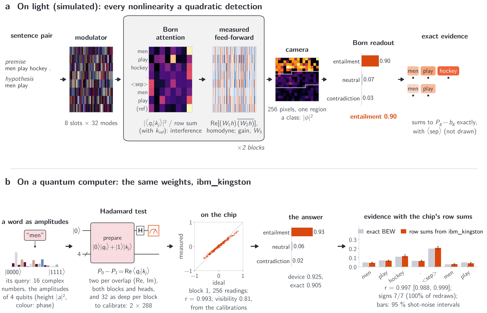
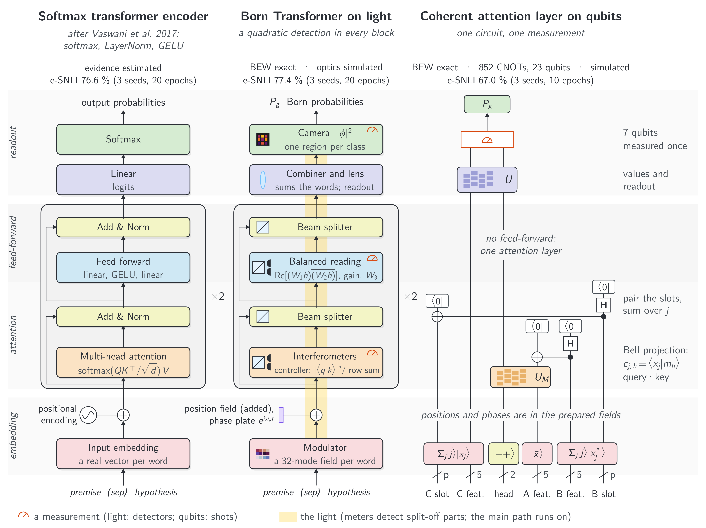

# Reading Why: Born-Measured Attention with Exact Word Evidence on Light and Qubits

Interactive companion to the paper by Teerawat Tongloy (KMITL), Jiraporn Pongsopa and Rangsan Jomtarak (Suan Dusit
University).

| | |
|---|---|
| Try it: type a premise and a hypothesis and see why the model answers (CPU, no install) | [](https://colab.research.google.com/github/stein-research/reading-why/blob/main/demo/demo.ipynb) |
| Train a model on e-SNLI (GPU) | [](https://colab.research.google.com/github/stein-research/reading-why/blob/main/demo/train.ipynb) |
| Run it on your own computer, and the paper's analyses | [docs/run-locally.md](docs/run-locally.md) |
| Paper | [arXiv:2611.05355](https://arxiv.org/abs/2611.05355) |
| Archived copy (always the latest version) | [doi:10.5281/zenodo.23938333](https://doi.org/10.5281/zenodo.23938333) |
| Earlier work | Seeing Why, [arXiv:2611.01993](https://arxiv.org/abs/2611.01993) ([code](https://github.com/stein-research/seeing-why)) |



*One test pair through the trained model: (a) on light (simulated), (b) on IBM's ibm_kingston, where only the
attention overlaps ran. Red words push towards the answer, blue against it; each word's Born evidence (BEW) sums to
the class probability above its share.*

A transformer in which every nonlinearity is a quadratic detection, so that its word evidence is exact:
**Born evidence per word (BEW)** adds up to the class probability above its share, with no quadrature error.

## How it works



*Three models step by step, bottom to top, in the box colours of the original transformer figure: a softmax
transformer encoder after Vaswani et al. 2017, the Born Transformer drawn as optics, and the coherent attention layer
drawn as its circuit, wires running upwards (one circuit, one measurement; a separate, smaller model, simulated
only). Bands hold the same stage; detector symbols mark the measurements.*

Each word $t$ enters as a complex field $a_t\,e_t$ with amplitude $a_t$. A block's attention weighs word $j$ for word
$i$ by

```math
w_{ij} = \frac{|\langle q_i|k_j\rangle|^2}{\sum_{j'} |\langle q_i|k_{j'}\rangle|^2},
```

which needs only overlaps (an interference on light, a Hadamard test on qubits; each returns the real or imaginary part) and a sum; the sum runs over the
words and a reference slot that carries the sentence mean. The feed-forward is a
measured product $\mathrm{Re}[(W_1h)\overline{(W_2h)}]$, written back by $W_3$. The readout splits the outcomes into
one group per class $g$ and reads $P_g$; with no information each class gets its share $b_g = |S_g|/256$ (86, 85 and 85 of the 256 camera pixels, about 1/3). With every
denominator held at the input, $F_g(a) = P_g - b_g$ is a polynomial in the word amplitudes (degree 200 at most), so integrated gradients from
the zero baseline,

```math
e_g(t) = a_t \int_0^1 \frac{\partial F_g}{\partial a_t}(\alpha a)\,d\alpha, \qquad \sum_t e_g(t) = P_g - b_g,
```

are computed with no quadrature error by Gauss-Legendre quadrature (the integrand has degree 199, so 100 nodes); in
double precision the sum holds to $10^{-13}$ or better. Red words push towards the answer, blue words against it.

## What the paper finds (e-SNLI, about 98k parameters outside the embedding, 3 seeds, 1,000 test pairs)

| | Born Transformer | softmax transformer |
|---|---|---|
| test accuracy | 77.45 +- 0.91 % | 76.62 +- 0.36 % |
| evidence sums to the explained score | to 1e-13 at most (no quadrature error) | approximated (integrated gradients) |
| deleting the word ranked first changes the answer: evidence / gradient x input / attention x gradient / random | 44 / 43 / 38 / 6 % | 32 / 14 / 40 / 5 % |
| ... at most (any single deletion, the ceiling) | 53 % | 55 % |
| deleting the five words ranked last changes it (evidence) | 1.2 % | 10 % |
| top words that annotators highlighted: evidence / attention (chance 0.35) | 0.52 / 0.51 | 0.46 / 0.54 |

What the numbers say, and what they do not:

- **Accuracy does not set the models apart.** An order-free bag of embeddings, with no attention, reaches
  77.79 +- 0.26 % under the same protocol.
- **Exactness buys the sum, not the best ranking.** The top-word deletion gain is the model's: its own gradient x
  input with nothing held does as well (43 %), so does the bag's (42 %), and leave-one-out does better. Holding the
  denominators improves the words ranked last and the agreement with annotators. Rankings by word position alone agree
  with the annotators better than any model (0.585).
- **On ibm_kingston** the attention of the two shortest test pairs was read by Hadamard tests and by compute-uncompute
  circuits. The device gave the model's answers, also without the one word that decides one pair; but random overlaps
  would pass these checks a quarter to two fifths of the time, and they test block 1 almost alone. With the device's
  row sums the evidence followed the exact one by Hadamard tests (correlation 0.997 and 0.962), not on one of the two
  compute-uncompute runs (0.48).
- **What the qubit realisation needs**, including a proposition on the shots per circuit the evidence needs, is in
  the paper's Section 5; the coherent attention layer (67 %, one post-selected circuit of 852 CNOTs on 23 qubits) is
  simulated only.

## Contents

| | |
|---|---|
| [`demo/`](demo/) | the two notebooks and their helpers ([`reading_why.py`](demo/reading_why.py), [`ui.py`](demo/ui.py)) |
| [`examples/`](examples/) | [`quickstart.py`](examples/quickstart.py) (the demo in a few lines) and [`explain.py`](examples/explain.py) (any pair from the command line) |
| [`docs/`](docs/) | [running it locally and reproducing the paper](docs/run-locally.md); the figures of this page |
| [`src/`](src/) | the models, the exact evidence, the trainer, the evaluations, the optical and qubit compiles, the quantum-resource analysis, and the scripts that ran the IBM jobs |
| [`results/`](results/) | the trained models of the tables (the Born Transformer, the softmax transformer and the unconstrained polynomial model, three seeds each), the ablation with the attention weight squared again ([`results/ablation/`](results/ablation/)), the coherent attention layer, the bag-of-embeddings baseline, and the vocabulary; see [`results/README.md`](results/README.md) |
| [`data/`](data/) | where e-SNLI goes (downloaded and checked, not stored) |
| [`ibm_jobs/`](ibm_jobs/) | every IBM job of the paper: circuits, calibration, raw counts (account details removed); [how to check or repeat them](docs/check-and-repeat-ibm.md). Earlier versions' jobs: commit 7d94f41 ("Version 3.1") |

## A century of the Born rule

> In June 1926, Max Born submitted [a short paper on collisions](https://doi.org/10.1007/BF01397477) and added a note
> in proof: the probability of an outcome is proportional to the squared modulus of its amplitude. A century later,
> that rule is at the heart of this model, linking its answers to evidence in the words it reads.
>
> We finish this work in 2026, the year the rule turns a hundred, and we want to name what it rests on. Max Born, and
> those who built quantum mechanics with him and around him: Werner Heisenberg and Pascual Jordan; Erwin Schrödinger,
> Paul Dirac and Wolfgang Pauli; Albert Einstein, whose “ghost field” helped inspire Born’s interpretation; Niels
> Bohr; and John von Neumann, who helped give the theory its rigorous mathematical foundation.
>
> Those who saw how quantum systems could compute, and those who built the interferometers, optical meshes and
> circuits that made those ideas practical. Those who gave machine learning the transformer, and those who kept asking
> what it means for a model to explain itself. The annotators who read sentence pairs and highlighted the words that
> explained the relation between them: without their work, we could not check our evidence against human judgment.
>
> The engineers who make quantum processors available to researchers far from where they are built, and the
> communities behind PyTorch, Qiskit and NumPy. The people behind PennyLane, whose simulator we used to cross-check
> the simulations in *Seeing Why*, the work this one builds on. Their tutorials were where one of us first learned
> quantum machine learning, by trying, failing and trying again. The authors whose papers we leaned on and argued
> with, and the colleagues who read our drafts and would not let a loose claim stand.
>
> If this work stands, it stands on their shoulders. What we add is small: another way to use Born’s rule, to give an
> answer and show how each word contributes to it.
>
> *The authors, 4 November 2026*

## Acknowledgements

We acknowledge the use of IBM Quantum services for this work. The views expressed are those of the authors, and do
not reflect the official policy or position of IBM or the IBM Quantum team.

## Use of AI tools

An AI assistant (Claude, Anthropic) was used under the authors' direction to write and run simulation and analysis
code, to prepare and check the hardware jobs, to write the code that draws the figures, to search the literature and
check the references against their sources, and to draft and revise the text; the authors chose what to cite. The
authors retained responsibility for the study design, the scientific judgments and the claims, checked the reported
results against the saved data and the code, and take full responsibility for the content.

## Licence and citation

Code: MIT ([`LICENSE`](LICENSE)). e-SNLI: MIT; SNLI sentences and the vocabulary derived from them: CC BY-SA 4.0
(see [`data/README.md`](data/README.md)). Please cite the paper ([`CITATION.cff`](CITATION.cff)).

```bibtex
@misc{tongloy2026readingwhy,
  title         = {Reading Why: Born-Measured Attention with Exact Word Evidence on Light and Qubits},
  author        = {Tongloy, Teerawat and Pongsopa, Jiraporn and Jomtarak, Rangsan},
  year          = {2026},
  eprint        = {2611.05355},
  archivePrefix = {arXiv},
  primaryClass  = {quant-ph},
  doi           = {10.48550/arXiv.2611.05355},
  url           = {https://arxiv.org/abs/2611.05355}
}
```
